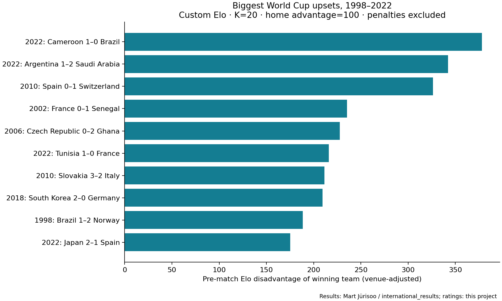
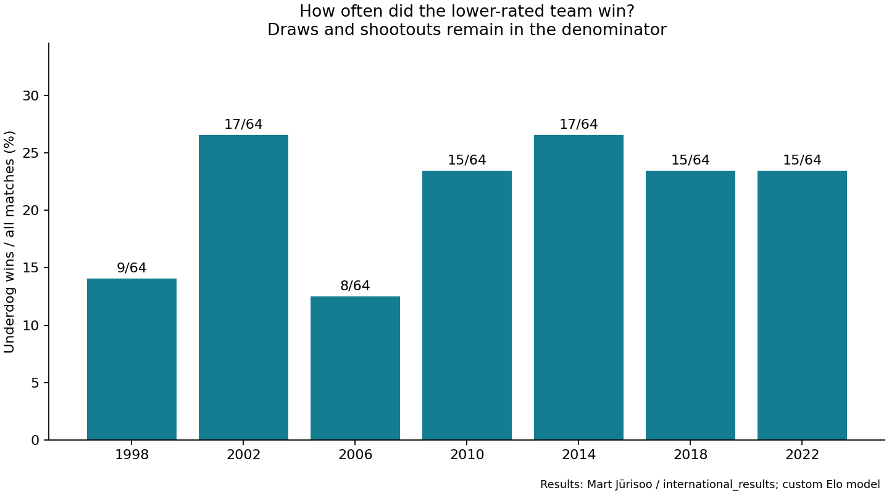

# World Cup Upsets

Which lower-rated teams won, and how large was their pre-match rating disadvantage?

A Python portfolio project using historical men's international results to construct custom Elo ratings, then evaluate **448 FIFA World Cup finals matches across 1998–2022**. These are project-built ratings, not official FIFA rankings, published World Football Elo ratings, or betting odds.

## Findings

With K=20 and a 100-point home advantage:

- Lower-rated teams won **96 of 448 matches (21.4%)**.
- Excluding **107 draws**, lower-rated teams won **96 of 341 decisive matches (28.2%)**.
- **18 wins** overcame a venue-adjusted disadvantage of at least **150 Elo points**, our chosen definition of a major upset.
- The largest rating-gap upset was **Cameroon 1–0 Brazil on December 2, 2022**, overcoming **378.2 points**. Argentina's **1–2 loss to Saudi Arabia** ranks second at **342.1 points**.

The top result illustrates a limitation: this simple team-history model has no player lineup, rotation, qualification-status, or match-incentive information. “Largest” means the largest rating disadvantage overcome within this model and analysis period.





## Reproduce

Python 3.10 or newer:

```bash
python -m venv .venv
# macOS/Linux
source .venv/bin/activate
# Windows PowerShell instead: .venv\Scripts\Activate.ps1
python -m pip install -r requirements.txt
python analyze.py
python -m unittest test_analysis.py
```

The bundled historical CSV permits offline reruns once dependencies are installed. A full run includes four Elo variants and may take several minutes. `analysis.ipynb` provides a guided walkthrough; Jupyter is optional and installed separately.

## Method

1. Retain historical matches from November 1872 through December 2022. Use earlier matches as rating history; report only the seven 1998–2022 World Cups. This deliberately fixed historical scope excludes 2026.
2. Initialize every newly observed team at **1,500**. Use the dataset's team names and historical successor mappings as supplied. Include all available men's international tournaments and friendlies in the rating history.
3. Calculate the adjusted rating gap as `home_rating − away_rating + home_advantage`. Apply the home adjustment only when `neutral = False`; neutral matches receive no adjustment.
4. Calculate Elo expected score: `E_home = 1 / (1 + 10 ** (−gap / 400))`. This estimates the Elo score **win=1, draw=0.5, loss=0**. It is **not a calibrated win probability**.
5. Update each team's rating by `K × (actual_score − expected_score)`. Use K=20 for every match, with no goal-margin multiplier, tournament weighting, inactivity decay, or parameter fitting.
6. All matches on the same date use start-of-day ratings. Apply accumulated updates only after that date, avoiding arbitrary within-day ordering when kickoff times are unavailable.
7. An upset is a win by the side with the lower venue-adjusted rating. Equal ratings and draws are not upsets. Rank upset wins by the absolute pre-match adjusted rating gap.

A 150-point threshold is an exploratory choice, not a natural statistical cutoff. `results/sensitivity.csv` varies K (20/40), home advantage (0/100) and the major-upset threshold (100/150/200). It includes the number of matches offering a major-underdog opportunity, so readers can distinguish upset frequency from unequal-match frequency. Across the four model variants, underdog wins range from **92 to 96** (20.5%–21.4% of all matches). At the 150-point threshold, major upsets range from **14 to 20**. These settings are not selected by maximizing the reported results.

## Data quality and outcome definitions

- The input snapshot contains **45,847 rows** through 2022. Two rows share the date/team key for Tahiti–New Caledonia on February 17, 1974 but have opposite scores. Both are quarantined, leaving **45,845 historical matches**. The original filtered snapshot remains intact; the excluded rows are exported separately.
- Validate required fields, nonnegative integer scores and neutral-ground flags. Check that each analyzed World Cup contains 64 matches.
- Source scores include extra time and exclude penalty shootouts. A tied score remains a draw even when a team advanced on penalties. This project measures match-result upsets, not knockout progression upsets, and does not isolate regulation-time results.
- Same-day updates are zero-sum. Tests cover update timing, home advantage, draw handling, future-result invariance and within-day ordering.
- Historical coverage, team identity changes, equal starting ratings and the inclusion of non-FIFA internationals can influence ratings. Results should be read as an exploratory baseline, not a definitive ranking of national-team strength or causal evidence.

## One-hour walkthrough

| Minutes | Activity |
| --- | --- |
| 0–10 | Inspect the source schema and quarantined duplicate-key rows |
| 10–25 | Follow the Elo formula and sequential rating updates |
| 25–40 | Inspect the top upsets and tournament comparison charts |
| 40–50 | Compare K, venue adjustment and threshold sensitivity |
| 50–60 | Explain denominators, shootout handling and model limitations |

## Project files

- `analyze.py`: cleaning, chronological Elo, summaries, sensitivity and charts.
- `test_analysis.py`: focused temporal and update-rule tests.
- `analysis.ipynb`: guided exploration.
- `data/results_through_2022.csv`: filtered source snapshot.
- `results/world_cup_match_ratings.csv`: all 448 matches with pre-match ratings.
- `results/ranked_upsets.csv`: all underdog wins in descending rating-gap order.
- `results/tournament_summary.csv`: counts and clearly defined percentages by tournament.
- `results/sensitivity.csv`: alternative settings and opportunity counts.
- `results/summary.json`: headline findings and source snapshot SHA-256.

## Sources and attribution

Historical match data: **Mart Jürisoo and contributors**, [international_results](https://github.com/martj42/international_results), [source CSV](https://raw.githubusercontent.com/martj42/international_results/master/results.csv), [data definitions](https://github.com/martj42/international_results/blob/master/README.md). Retrieved October 18, 2026 UTC; transformed only by retaining dates through December 31, 2022 and serializing the CSV. The input hash is recorded in `results/summary.json`.

This is a community-maintained dataset of FIFA World Cup and other international matches, not an official FIFA data feed. The source documentation describes historical team-name mappings and score conventions. Upstream data terms apply; this repository does not claim ownership of the source data. This project is independent of FIFA.
